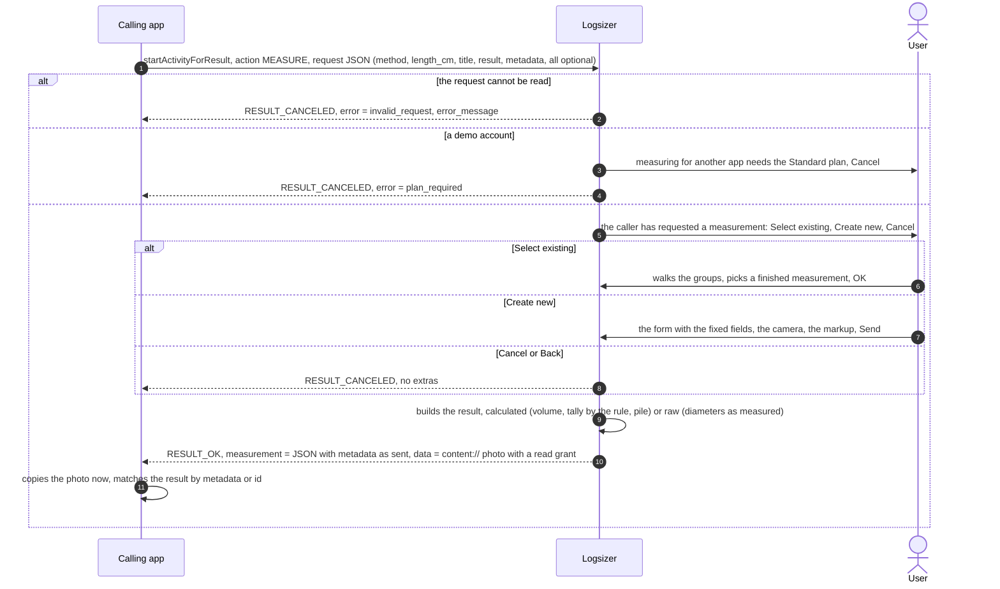

# Logsizer API Caller

A one-screen Android app that calls the public API of **Logsizer**, the timber
measurement app (`com.fosize.android`), and shows what comes back. It is the reference
integration for anyone writing one, and the tool the Logsizer team tests the API with.

## The API in brief

Another app starts Logsizer with one action and an optional JSON request. The user
measures as usual in Logsizer — or picks a measurement already made — and presses
**Send**; the caller gets a JSON description of the measurement and the photo with the
markup. The API is a feature of Logsizer's Standard plan.



```kotlin
val measure = registerForActivityResult(StartActivityForResult()) { result ->
    val data = result.data
    when {
        result.resultCode == RESULT_OK -> {
            val measurement = data!!.getStringExtra("measurement")   // the JSON below
            val photo = data.data                                     // content:// uri; read it now
        }
        data?.hasExtra("error") == true -> {                          // the app could not measure
            val error = data.getStringExtra("error")
        }
        else -> { /* the user cancelled */ }
    }
}

measure.launch(
    Intent("com.fosize.android.action.MEASURE")
        .setPackage("com.fosize.android")
        .putExtra("request", """{"method": "pile", "length_cm": 300, "title": "Lot 142"}""")
)
```

On Android 11 and later, declare the action in your manifest to be able to ask whether
Logsizer is installed (`resolveActivity`); starting the activity works without it:

```xml
<queries>
    <intent>
        <action android:name="com.fosize.android.action.MEASURE" />
    </intent>
</queries>
```

### The request

The `request` extra, a JSON object. Every field is optional, and so is the extra: an
intent with no request at all means *measure something and tell me the result*.

| Field | Type | What it does | When absent |
|-------|------|--------------|-------------|
| `method` | `"by_the_piece"`, `"pile"` or `"manual_pile"` | restricts the measurement to that method: the picker offers only such measurements, the new-measurement form has the method fixed | the user chooses |
| `length_cm` | positive integer | the log length, filled into the form and not editable | the user enters it |
| `title` | string | the measurement's name, filled into the form and not editable | Logsizer's default name |
| `result` | `"calculated"` or `"raw"` | what the result holds: the calculation Logsizer shows, or the measurements alone | `calculated` |
| `metadata` | any JSON value | your own tag — a lot number, a record id, an object of them — returned in the result as it came, so you can match the result to your record without keeping state. Keep it small: it travels in the intent both ways | nothing comes back; an empty value counts as absent |

Only finished measurements are offered and returned — a gauge marked and a result on
the screen. A request that does not parse, a value the contract does not know or a
length that is not a positive integer is refused with `invalid_request`.

### The result

`RESULT_OK` with the `measurement` extra, a JSON object, and the photo — the photograph
with the markup drawn on it, as a JPEG — as the intent's **data**, a `content://` uri
with a read grant. The grant and the file are temporary: copy the photo as soon as the
result arrives, as this app does.

Calculated (the default), metric throughout:

```json
{
  "id": "6d2a3f0e-5c1b-4f0a-9d2e-8b7c6a5d4e3f",
  "method": "pile",
  "title": "Lot 142",
  "length_cm": 300,
  "volume_m3": 21.56,
  "logs": {
    "count": 202,
    "rule": "cylinder",
    "diameters": [
      { "diameter_cm": 24, "count": 12, "volume_m3": 1.63 },
      { "diameter_cm": 26, "count": 31, "volume_m3": 4.94 }
    ]
  },
  "pile": { "width_cm": 887, "height_cm": 340, "area_m2": 30.15, "density": 0.72 },
  "location": { "latitude": 54.3712, "longitude": 18.6128 },
  "metadata": { "lot": 142, "yard": "north" }
}
```

| Field | Always | Holds |
|-------|--------|-------|
| `id` | yes | the measurement's id in Logsizer; the same measurement sent twice comes with the same id |
| `method` | yes | `by_the_piece`, `pile` or `manual_pile` |
| `title`, `length_cm` | yes | the measurement's name and the log length the volume was computed with |
| `volume_m3` | yes | the measurement's volume as Logsizer shows it: by the piece, the sum of the logs by the rule; a pile, area × length × density |
| `logs` | when logs were detected | `count`; `rule`, the log rule the volumes were computed by (`gost_2708_75_2cm`, `cylinder`, `doyle`, `poland`, `jas`, `middle_diameter`, `manitoba_cubic`, `nova_scotia_cubic`, `cubic_metre_rule`, `international_1_4`, `roy_log_rule`, `ontario_log_rule`, `scribner_decimal_c`); `diameters`, the tally — one row per diameter class of the rule, ascending |
| `pile` | for a pile | the contour's extent and area, and the density coefficient the volume was multiplied by (1 = stacked volume) |
| `location` | when Logsizer had a fix | the coordinates the measurement was stamped with |
| `metadata` | when the request carried one | the request's `metadata`, as it came |

Raw (`"result": "raw"`) carries `id`, `method`, `title`, `length_cm`, `location` and
`metadata` as above, `diameters_cm` — one value per log as measured, to a hundredth of a
centimetre, not rounded to any rule — and the same `pile` block for a pile; no volume,
no rule, no tally.

### Errors

`RESULT_CANCELED` with no extras is the user: Back, or **Cancel** on the first screen.
`RESULT_CANCELED` with an `error` extra is Logsizer:

| `error` | Means |
|---------|-------|
| `invalid_request` | the request could not be read; `error_message` says what was wrong |
| `plan_required` | the account is on the demo plan; the API needs the Standard plan |
| `failed` | Logsizer could not produce the result; `error_message` says why |

A new optional field may be added to the request or the result at any time; ignore what
you do not know.

## The screen

1. Whether Logsizer is installed on the device.
2. Presets for the requests worth trying: none at all, each method — the pile ones
   carrying a `metadata` tag the result must echo — a raw result, and a malformed one.
   A preset fills the text field; the text can be edited before it goes, so any request
   can be tried.
3. **Send no request extra at all** starts Logsizer with the action alone.
4. **Send to Logsizer** starts it for a result — `registerForActivityResult`, so
   Logsizer learns who asks and names this app on its first screen.
5. The result: the code, what was sent, every extra of the result by name (a JSON
   extra laid out), the photo's uri and the photo itself.

## Building

AGP 9.4.1, Kotlin 2.4.10, Gradle 9.7, a JDK 21 for the daemon
(`gradle/gradle-daemon-jvm.properties`; the foojay resolver downloads one where none is
installed), the Android SDK named in `local.properties` (`sdk.dir=…`). `minSdk` is 30.

```bash
./gradlew :app:installDebug      # build and install on the attached device
./gradlew :app:testDebugUnitTest # the presets against the contract
```

Nothing is signed for release: this app is installed from a developer's machine, never
published.
