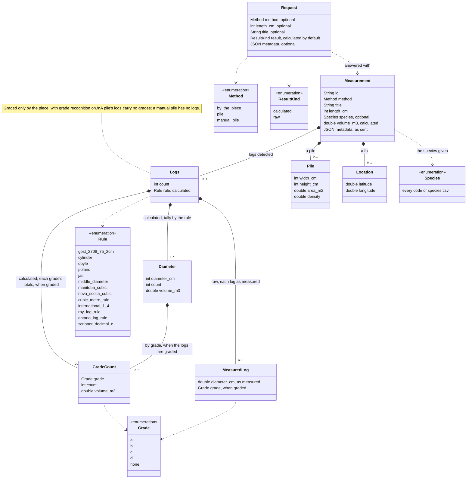

# Logsizer API Caller

A one-screen Android app that calls the public API of **Logsizer**, the timber
measurement app (`com.fosize.android`), and shows what comes back. It is the reference
integration for anyone writing one, and the tool the Logsizer team tests the API with.

## The API in brief

Another app starts Logsizer with one action and an optional JSON request. The user
measures as usual in Logsizer — or picks a measurement already made — and presses
**Send**; the caller gets a JSON description of the measurement and the photo with the
markup. The API is a feature of Logsizer's Standard plan.



```kotlin
val measure = registerForActivityResult(StartActivityForResult()) { result ->
    val data = result.data
    when {
        result.resultCode == RESULT_OK -> {
            val measurement = data!!.getStringExtra("measurement")   // the JSON below
            val photo = data.data                                     // content:// uri; read it now
        }
        data?.hasExtra("error") == true -> {                          // the app could not measure
            val error = data.getStringExtra("error")
        }
        else -> { /* the user cancelled */ }
    }
}

measure.launch(
    Intent("com.fosize.android.action.MEASURE")
        .setPackage("com.fosize.android")
        .putExtra("request", """{"method": "pile", "length_cm": 300, "title": "Lot 142"}""")
)
```

On Android 11 and later, declare the action in your manifest to be able to ask whether
Logsizer is installed (`resolveActivity`); starting the activity works without it:

```xml
<queries>
    <intent>
        <action android:name="com.fosize.android.action.MEASURE" />
    </intent>
</queries>
```

### The request

The `request` extra, a JSON object. Every field is optional, and so is the extra: an
intent with no request at all means *measure something and tell me the result*.

| Field | Type | What it does | When absent |
|-------|------|--------------|-------------|
| `method` | `"by_the_piece"`, `"pile"` or `"manual_pile"` | restricts the measurement to that method: the picker offers only such measurements, the new-measurement form has the method fixed | the user chooses |
| `length_cm` | positive integer | the log length, filled into the form and not editable | the user enters it |
| `title` | string | the measurement's name, filled into the form and not editable | Logsizer's default name |
| `result` | `"calculated"` or `"raw"` | what the result holds: the calculation Logsizer shows, or the measurements alone | `calculated` |
| `metadata` | any JSON value | your own tag — a lot number, a record id, an object of them — returned in the result as it came, so you can match the result to your record without keeping state. Keep it small: it travels in the intent both ways | nothing comes back; an empty value counts as absent |

Only finished measurements are offered and returned — a gauge marked and a result on
the screen. A request that does not parse, a value the contract does not know or a
length that is not a positive integer is refused with `invalid_request`.

### The result

`RESULT_OK` with the `measurement` extra, a JSON object, and the photo — the photograph
with the markup drawn on it, as a JPEG — as the intent's **data**, a `content://` uri
with a read grant. The grant and the file are temporary: copy the photo as soon as the
result arrives, as this app does.

Calculated (the default), metric throughout:

```json
{
  "id": "6d2a3f0e-5c1b-4f0a-9d2e-8b7c6a5d4e3f",
  "method": "pile",
  "title": "Lot 142",
  "length_cm": 300,
  "species": "scots_pine",
  "volume_m3": 21.56,
  "logs": {
    "count": 202,
    "rule": "cylinder",
    "diameters": [
      { "diameter_cm": 24, "count": 12, "volume_m3": 1.63 },
      { "diameter_cm": 26, "count": 31, "volume_m3": 4.94 }
    ]
  },
  "pile": { "width_cm": 887, "height_cm": 340, "area_m2": 30.15, "density": 0.72 },
  "location": { "latitude": 54.3712, "longitude": 18.6128 },
  "metadata": { "lot": 142, "yard": "north" }
}
```

| Field | Always | Holds |
|-------|--------|-------|
| `id` | yes | the measurement's id in Logsizer; the same measurement sent twice comes with the same id |
| `method` | yes | `by_the_piece`, `pile` or `manual_pile` |
| `title`, `length_cm` | yes | the measurement's name and the log length the volume was computed with |
| `species` | when the measurement has one | the species the user gave it, as a code from [`species.csv`](species.csv) — `scots_pine`, `pedunculate_oak` |
| `volume_m3` | yes | the measurement's volume as Logsizer shows it: by the piece, the sum of the logs by the rule; a pile, area × length × density |
| `logs` | when logs were detected | `count`; `rule`, the log rule the volumes were computed by (`gost_2708_75_2cm`, `cylinder`, `doyle`, `poland`, `jas`, `middle_diameter`, `manitoba_cubic`, `nova_scotia_cubic`, `cubic_metre_rule`, `international_1_4`, `roy_log_rule`, `ontario_log_rule`, `scribner_decimal_c`); `diameters`, the tally — one row per diameter class of the rule, ascending, with its `grades` when the logs have grades; `grades`, each grade's totals, when they have — a measurement by the piece with grade recognition on (*Grades*, below) |
| `pile` | for a pile | the contour's extent and area, and the density coefficient the volume was multiplied by (1 = stacked volume) |
| `location` | when Logsizer had a fix | the coordinates the measurement was stamped with |
| `metadata` | when the request carried one | the request's `metadata`, as it came |

Raw (`"result": "raw"`) carries `id`, `method`, `title`, `length_cm`, `species`,
`location` and `metadata` as above, `logs` with `count` and `measured` — one object per log:
its `diameter_cm` as measured, to a hundredth of a centimetre, not rounded to any rule, and its
`grade` when the logs have grades — and the same `pile` block for a pile; no volume, no rule,
no tally.

**Breaking change in Logsizer 1.6.0.** Logsizer 1.5.0 answered a raw result with
`diameters_cm`, the diameters as a bare list of numbers. From 1.6.0 they come as
`logs.measured`, and `diameters_cm` is gone, under the same action: a caller written for
1.5.0's raw result finds nothing where it looked and has to be updated. The calculated result
only gained fields.

### Grades

A log can carry a grade, A to D: the one the paint mark on its face names under the
measurement's colours, or one set by hand on the markup. Only a measurement by the piece
grades its logs, and only while its **grade recognition** is on. The user decides that, not
the request: Logsizer's new-measurement form offers **Recognize grades by color** for a
measurement by the piece, on by default, and the measurement's menu turns it on or off later —
off, every grade goes, a hand-set one among them. When at least one log of the measurement
has a grade, the result carries them in either kind.

**Calculated**: every row of `logs.diameters` carries `grades` — the row's logs by grade,
`a` to `d` and then `none`, only the grades the row has logs of, each with its `count` and
`volume_m3`. They add up to the row, up to the rounding of each volume to four decimals:

```json
{
  "diameter_cm": 24, "count": 12, "volume_m3": 1.63,
  "grades": [
    { "grade": "a", "count": 5, "volume_m3": 0.68 },
    { "grade": "c", "count": 4, "volume_m3": 0.54 },
    { "grade": "none", "count": 3, "volume_m3": 0.41 }
  ]
}
```

Beside the rows, `logs.grades` holds each grade's totals over all of them, in the same
order — what the Calculation tab lists under its totals row:

```json
"grades": [
  { "grade": "a", "count": 5, "volume_m3": 0.68 },
  { "grade": "b", "count": 20, "volume_m3": 3.19 },
  { "grade": "c", "count": 4, "volume_m3": 0.54 },
  { "grade": "none", "count": 14, "volume_m3": 2.16 }
]
```

**Raw**: every log of `logs.measured` carries its `grade`:

```json
"logs": {
  "count": 3,
  "measured": [
    { "diameter_cm": 23.41, "grade": "a" },
    { "diameter_cm": 25.08, "grade": "none" },
    { "diameter_cm": 24.97, "grade": "c" }
  ]
}
```

`none` is a log without a grade: no mark Logsizer saw, a mark of a colour no grade has
(orange and white are not offered), or a grade taken away by hand. A measurement none of
whose logs has a grade carries no `grades` at all, and its result is what it always was: a
pile — its logs are not graded — and a manual pile, which has no logs; a measurement by the
piece with its grade recognition off; one whose colours name no paint; one made before
Logsizer read marks and not graded since. Which paint marks which grade is the measurement's
own, from Logsizer's Settings; the result does not carry it, nor whether recognition is on.
The photo shows each graded log's badge — a disc of its grade's paint with the letter on the
log's outline — as the markup does.

### Logsizer versions

The action has answered since Logsizer 1.5.0. What changed in the result since, by the
version that changed it:

| Logsizer | The result |
|----------|------------|
| 1.5.0 | the API's first release; a raw result carries the diameters as `diameters_cm`, a bare list of numbers |
| 1.6.0, 1.6.1 | the grades: `grades` in each row of the tally and `logs.grades`, a `grade` on each log of a raw result — the logs of a measurement by the piece and of a pile alike; a raw result's diameters move to `logs.measured`, one object per log, and `diameters_cm` is gone — the one breaking change |
| 1.6.2 and later | only a measurement by the piece with its grade recognition on is graded: a pile's result carries no grades, and nor does a measurement whose user turned recognition off. No field changed — the grades were always there only when the logs had them |

A result says nothing of the version that wrote it: read what is there, and ignore what you
do not know.

### Species

[`species.csv`](species.csv) lists every code `species` can take, with the species'
Latin and English names — the list Logsizer offers, generated from it. The list only
grows and a code never changes its meaning; a code your copy does not have is a species
added since, so take a newer copy of the file rather than refuse the result.

### Errors

`RESULT_CANCELED` with no extras is the user: Back, or **Cancel** on the first screen.
`RESULT_CANCELED` with an `error` extra is Logsizer:

| `error` | Means |
|---------|-------|
| `invalid_request` | the request could not be read; `error_message` says what was wrong |
| `plan_required` | the account is on the demo plan; the API needs the Standard plan |
| `failed` | Logsizer could not produce the result; `error_message` says why |

A new optional field may be added to the request or the result at any time; ignore what
you do not know.

## The screen

1. Whether Logsizer is installed on the device.
2. Presets for the requests worth trying: none at all, each method — the pile ones
   carrying a `metadata` tag the result must echo — a raw result, and a malformed one.
   A preset fills the text field; the text can be edited before it goes, so any request
   can be tried.
3. **Send no request extra at all** starts Logsizer with the action alone.
4. **Send to Logsizer** starts it for a result — `registerForActivityResult`, so
   Logsizer learns who asks and names this app on its first screen.
5. The result: the code, what was sent, every extra of the result by name (a JSON
   extra laid out), the photo's uri and the photo itself.

## Installing

Every commit on `master` publishes a [release](../../releases) with the APK, signed
with the project's key, numbered by the build (`1.0.N`) so that each one installs over
the one before. Download it to the phone and open it; Android asks once to allow
installing from that source.

## Building

AGP 9.5.0, Kotlin 2.4.10, Gradle 9.7, a JDK 21 for the daemon
(`gradle/gradle-daemon-jvm.properties`; the foojay resolver downloads one where none is
installed), the Android SDK named in `local.properties` (`sdk.dir=…`). `minSdk` is 30.

```bash
./gradlew :app:installDebug      # build and install on the attached device
./gradlew :app:testDebugUnitTest # the presets against the contract
```

GitHub Actions (`.github/workflows/build.yml`) builds the debug APK and runs the tests
on every push, keeping the APK as the run's artifact, and on `master` also builds the
release APK with the keystore held in the repository's secrets and publishes it. A
release build on a developer's machine, without that keystore, is unsigned.
